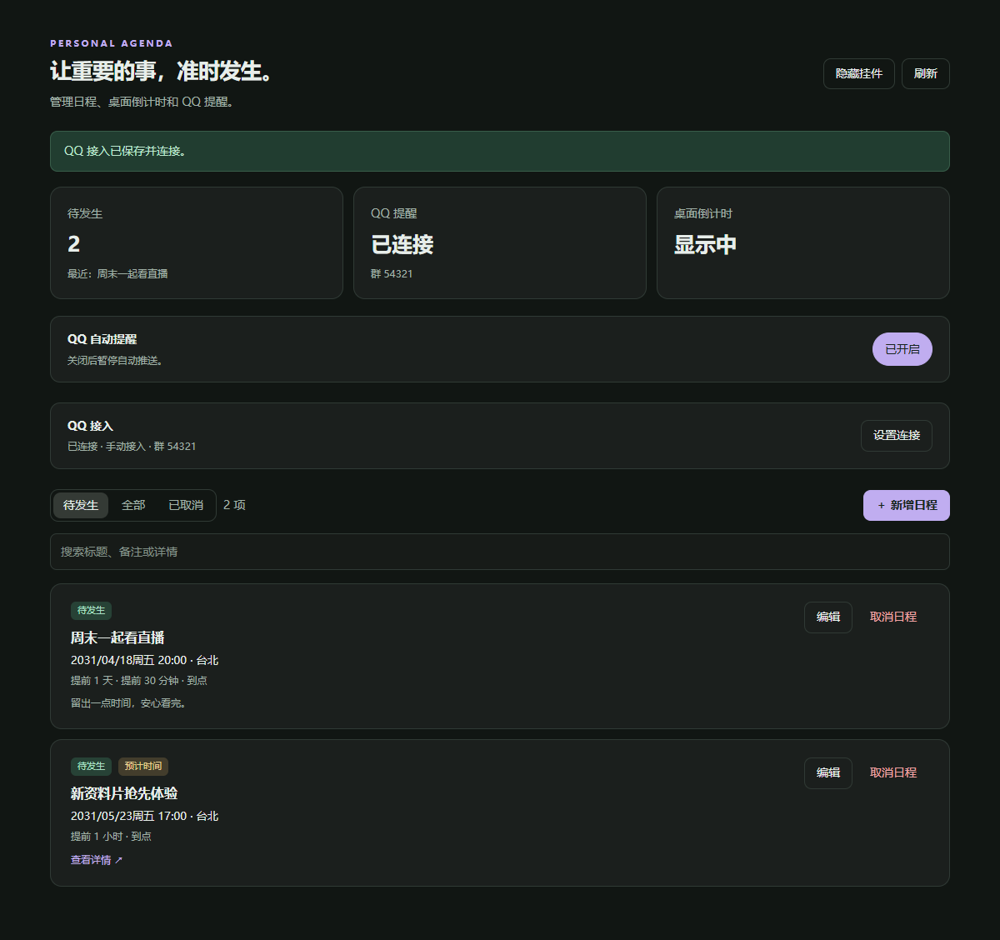
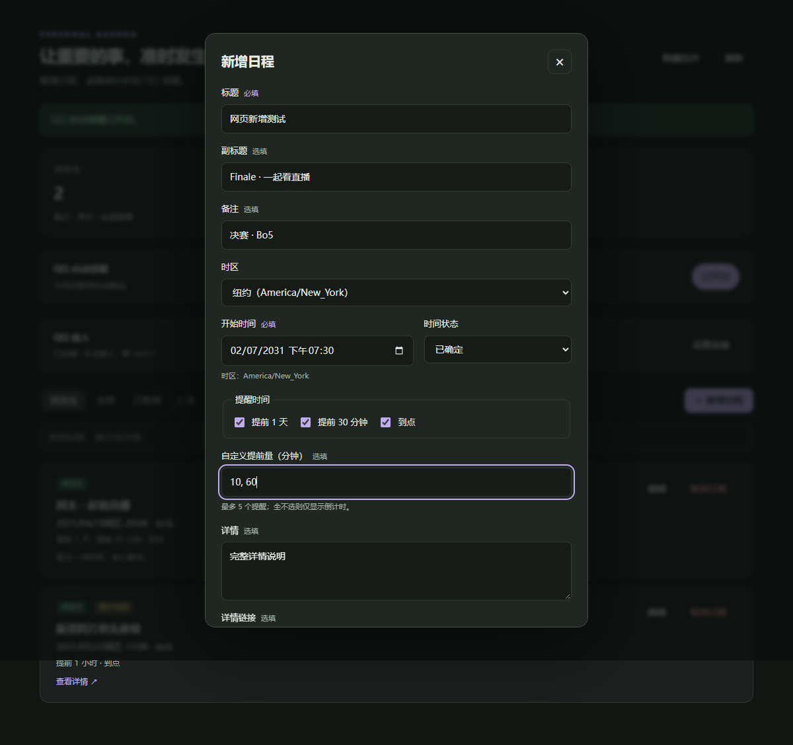
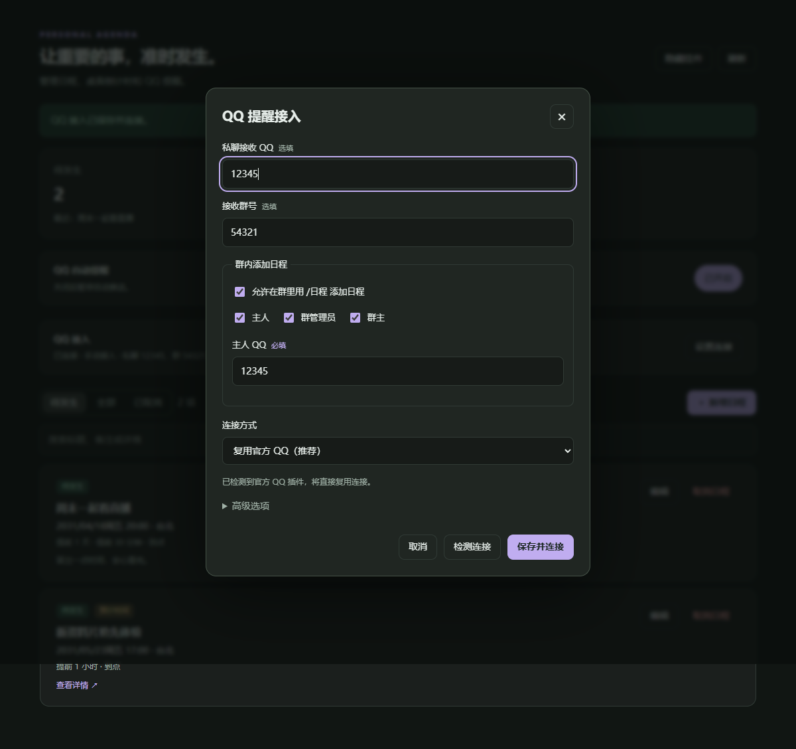

# Coopanion 个人日程

独立的本地 World 插件：**个人日程**，包含 QQ 提醒与桌面倒计时。不修改 Coopanion 主程序，不向本体托盘插入菜单，也不创建额外托盘图标。所有开关放在插件页面。

目前按 Windows + Coopanion 0.2.20 / World 契约 6 验证。桌面窗口需要本机 Coopanion 的 Electron 运行环境；安装脚本在数据目录中准备独立副本，仓库不包含运行二进制。



## 个人日程

- 页面新增、编辑、取消、重新启用日程；查看待发生、全部和已取消事项，按标题或备注搜索。
- 每条日程在新增、编辑窗口中独立选择时区，默认跟随电脑；可标记已确定或预计时间，分别编辑标题、副标题、备注、详情和 HTTPS 链接，文字不限语言。
- 设置到点、提前一天、提前 30 分钟，或自定义整数分钟；每项最多 5 次，也可不发提醒。
- 手动指定的私聊 QQ 支持日程命令；已配置 Coopanion 语言模型时还可直接用自然语言管理。可另填一个群号接收同一份日程的提醒。
- 群内添加日程提供总开关，以及「允许主人」「允许群管理员」「允许群主」三个独立权限，默认全部关闭；私聊 QQ、群号、主人 QQ 默认全部留空，均需自行填写。
- 页面提供独立的「QQ 自动提醒」开关，设置会保存；关闭自动推送仍可编辑日程、查看桌面倒计时和通过 QQ 私聊管理。
- 页面提供 QQ 首次接入、连接检测和高级选项；默认复用官方 QQ 的地址及令牌，用户填写提醒接收人即可。未配置 QQ 时，日程和倒计时仍可独立使用。
- 倒计时与 QQ 提醒读取同一份日程。改期、取消、提醒去重和失败重试保留；更改标题不会重新发送已确认的提醒。
- 编辑冲突会提示重新打开，不覆盖其他页面或 QQ 的新改动。取消是停用，不删除历史。



日程显示字段对应关系：

| 页面字段 | 数据字段 | 填写要求 | 用途 |
| --- | --- | --- | --- |
| 标题 | `title` | 必填 | 倒计时的大字标题 |
| 副标题 | `subtitle` | 选填 | 标题下方的小字，留空隐藏 |
| 备注 | `remark` | 选填 | 挂件顶部的短标签，例如「演出 · 线上直播」 |
| 详情 | `details` | 选填 | 完整说明、长文本，QQ 提醒会附上 |
| 开始时间 | `start` | 必填 | 日程开始时间，按页面选择的时区输入 |
| 时区 | `timezone` | 默认跟随电脑 | 仅影响这条日程，可选择其他地区 |
| 详情链接 | `url` | 选填 | 填写时须使用 HTTPS 地址 |

标题、副标题、备注和详情均不限制语言。旧的「标题｜标签」仍可读取，旧 `notes` 作为详情读取；通过页面保存后写入独立字段。不再按日程编号强制套用显示内容。清空备注会隐藏顶部标签，清空副标题会隐藏对应小字。

时间状态默认「已确定」，启用状态默认开启。新日程默认提前一天、提前 30 分钟和到点提醒；自定义提前量选填，与勾选项合计最多 5 个，每个为 0–43200 的整数分钟。取消全部勾选并清空自定义提前量后只显示倒计时，不自动提醒。

每条日程的「时区」位于新增、编辑窗口中，列表、QQ 提醒与桌面倒计时分别按各项自身时区显示。新日程默认跟随运行 Coopanion 的电脑，也可选择 IANA 地区时区，例如 `Asia/Tokyo`、`Europe/London` 或 `America/New_York`。编辑已有日程时，若时间尚未修改，切换时区会自动换算输入框并保留实际时刻；如果已经输入了新时间，则按新选择的时区解释输入。其他日程及提醒回执不受影响。

会按事件日期处理夏令时。不存在的当地时刻不能保存，夏令时结束造成的重复时段需明确选择第一次或第二次；命令遇到重复时段时可改用网页选择。QQ 新增命令默认跟随电脑，修改命令沿用该项时区，可在时间后写 `@Asia/Tokyo` 等地区时区；自然语言可直接说明地区，例如「纽约明晚八点提醒我」。

时区保存在每个事件的 `timezone` 字段中，值为 `local` 或地区时区。旧记录未包含该字段时继续沿用旧文件顶层的时区，没有旧设置才跟随电脑；编辑保存时会把旧设置写入该条日程。旧文件无需重置，新建日程不受旧文件全局设置影响。

插件通过仅本机监听的 OneBot v11 转接通道接入官方 QQ：OneBot 常用端口为 `3001`，日程转接端口默认 `3002`。只处理指定接收人的日程私聊，以及指定群中符合权限的明确添加命令，其他消息和 QQ API 请求原样转发。停用时尝试通过官方 QQ 控制面恢复原上游地址；控制面关闭或不兼容时，需要在 QQ 接入页手动改回原地址。该机制依赖官方 QQ 控制面，未来接口变化仍可能需要适配。

当前已验证官方 `cortico-world-qq@0.2.15` 的实际连接驱动：身份初始化、普通私聊和群消息转发，以及上游连接断开后的重新连接。测试使用本机模拟 OneBot 服务，不向真实 QQ 发送测试消息。以上兼容性结论对应 Coopanion 0.2.20 / World 契约 6，不代表网络或 QQ 账号异常时永不断线。

## 安装

需要 Node.js 22+（建议 24）、Windows 和已安装的 Coopanion。网页日程和倒计时可先独立使用；QQ 提醒需要已登录的 OneBot v11（如 NapCat），推荐使用已配置好的官方 QQ 插件。先下载本仓库，在目录中运行：

```powershell
npm run build
npm run install:coopanion
```

默认安装目录为 `%LOCALAPPDATA%/Programs/Coopanion`。可显式指定目录和本机 API：

```powershell
node scripts/install.mjs --app="D:/Apps/Coopanion" --api=http://127.0.0.1:17788
```

脚本复制独立窗口运行环境，随后通过 Coopanion 的扩展安装接口登记日程本地包。它不修改主程序，也不覆盖用户日程、密钥或提醒记录。如果管理端需要认证，可先用脚本准备文件，再在已登录的扩展管理页选择 `data/local-extensions/` 下的对应目录安装。

### 首次使用与 QQ 接入

1. 安装后按扩展管理器提示重启核心，在 World 中启用「个人日程」。此时即可新增、编辑日程和使用倒计时，不必先配置 QQ。
2. 需要 QQ 提醒时，打开「个人日程 → QQ 接入 → 设置连接」。
3. 按需要填写「私聊接收 QQ」和／或「接收群号」，保持默认「复用官方 QQ」。两个目标都默认留空，不读取或推荐官方 QQ 的聊天对象，主人也不会自动加入。地址和令牌从本部署官方 QQ 配置中读取，令牌不回显。
4. 点击「检测连接」验证登录身份，再点击「保存并连接」。检测不发送任何 QQ 消息；它验证连通和登录，不等于已验证最终消息送达，实际提醒以发送回执为准。
5. 没有官方 QQ 配置时可选择「手动连接 OneBot」，填写 `ws://` 或 `wss://` 地址与访问令牌；服务本身未设置令牌时勾选对应选项。留空密码框会保留已保存的令牌。



不再需要 QQ 接入时，将私聊 QQ 和群号均留空并关闭群内添加后保存，日程和倒计时继续使用；只想关闭自动推送则使用页面的「QQ 自动提醒」开关。保存连接不必重启整个日程插件，也不会重置已有事项或回执。

### 群聊提醒与添加权限

私聊与群聊共享一份日程；配置两者后，每条有效提醒会分别发送，成功回执和失败重试按接收目标记录。只填群号也可使用，不需要填写私聊 QQ 或主人 QQ。首次接入不会发送欢迎或接入通知。

需要在群里添加时，打开「允许在群里用命令添加日程」，再勾选至少一种身份：

| 权限 | 允许的发送人 |
| --- | --- |
| 允许主人 | 手动填写的「主人 QQ」，仅用于权限判断，不会因此收到私聊提醒 |
| 允许群管理员 | OneBot 上报身份为 `admin` 的成员 |
| 允许群主 | OneBot 上报身份为 `owner` 的成员 |

三种身份分别生效，可同时勾选；群主不会因为只勾选管理员而自动获得权限。总开关和身份开关默认全部关闭。仅在填写的接收群里处理 `/日程 添加 2030-11-10 20:00 事项标题`，可在时间后加 `@Asia/Tokyo` 等时区；其他群、普通聊天、未授权成员均不触发本模块。回复只含新建事项并留在该群，不附上其他日程清单。群内不开放清单查询、修改、取消或自然语言管理。

从旧版升级时，旧 `ownerQQ` 不会自动迁入新的接收人或主人字段。需在页面自行填写后才恢复 QQ 日程提醒；现有日程、倒计时和投递记录保留，旧接收人重新填入后仍沿用已有成功回执。

高级选项可调整日程转接端口（默认 `3002`）和 Coopanion 本机接口端口（默认 `17788`）。转接端口不可与 OneBot 相同；端口占用、地址错误、令牌不匹配及登录异常会显示具体原因。官方连接未设置令牌时可直接复用。

手动填写的令牌使用宿主密钥接口保存到部署 `.env`，配置只保存密钥引用，页面不会返回或回填明文。复用官方 QQ 时不复制其令牌到新配置。旧 `PERSONAL_AGENDA_ONEBOT_TOKEN` 继续兼容，不要求新用户编辑 `.env`；示例文件仅供维护参考。切换连接方式不会修改官方 QQ 的令牌。

QQ 日程命令需官方 QQ 连入日程的本机转接通道；页面会显示该状态。手动模式只在官方 QQ 使用同一上游或原日程转接地址时切换，其他 QQ 地址不会被强改。若官方 QQ 不可用，网页编辑、倒计时和已连通的独立自动提醒仍可使用；停用日程后请检查官方 QQ 是否已恢复原地址。

自然语言理解自动复用 Coopanion 当前启用的语言模型端点（`activeProvider`，或任意已配置的 `coo` / `openai-responses-compat` 端点）。没有配置语言模型时，网页编辑、确定格式的 `/日程` 命令仍可用；自然语言理解会提示不可用，提醒表达退回准确事实。

## 数据和更新

数据位于部署的 `data/` 目录：

| 文件 | 用途 |
| --- | --- |
| `personal-agenda.json` | 日程内容 |
| `personal-agenda-delivery.json` | 提醒回执和去重状态 |
| `personal-agenda-dialogue.json` | 近期日程对话 |
| `countdown-window.json` | 窗口位置及显示设置 |

新安装从空日程开始，不含作者的真实日程。不要删除投递记录来测试，否则可能重复提醒。更改代码后增加插件版本号、重新构建安装，再重启核心加载；同名本地目录更新不会初始化新数据。主程序更新不会覆盖本插件目录，但宿主契约、QQ 控制面、Windows 设备接口变化仍可能需要适配。

倒计时窗口由日程插件管理，通过本机会话管道接收显示/隐藏操作；父进程结束后自动退出。隐藏挂件不等于停用日程提醒；暂停 Coopanion 会暂停提醒，读取暂停状态失败时也暂停发送。

「QQ 自动提醒」保存在 `worlds.personal-agenda.qqRemindersEnabled`，默认开启。关闭不会断开普通 QQ、取消日程或清空投递记录；再次开启时恢复仍在有效期内的提醒，过期的不补发。已交给 QQ 发送的消息无法通过关闭开关撤回。

QQ 与本地文件无法组成跨系统事务：在消息已发送、回执未落盘的极短窗口内崩溃，仍可能在重试时重复。这是已知限制，不能保证绝对 exactly-once。

## 开发与验证

```sh
npm test
npm run build
```

单元测试无网络依赖，不读取真实用户数据或发送 QQ 消息。浏览器界面测试需要安装开发依赖及 Chrome：

```sh
npm install
npm run test:ui
```

可用 `CHROME_PATH` 指定 Chrome/Chromium。界面测试使用隔离资料目录和模拟 RPC，验证空白接收目标、群内身份权限、仅群聊接入、只读检测、令牌不回显、时区切换、夏令时重复时段选择、新增、自定义提醒、冲突、取消、移动布局和卸载清理；截图写入忽略的 `preview/`。README 截图使用虚构示例。

## 发布范围与许可

仓库只包含源码、测试、文档、构建后的插件前端和自绘图标；不含 QQ 号配置、密钥、真实日程、聊天记录、睡眠记录、安装目录备份或 Electron 二进制。发布包名 `cortico-world-personal-agenda`，可通过 npm / Coopanion 扩展市场或本地扩展目录安装。

本项目代码使用 MIT 许可。vendored `ws` 保留自己的 MIT 版权和许可，见 [THIRD_PARTY_NOTICES.md](THIRD_PARTY_NOTICES.md)。
