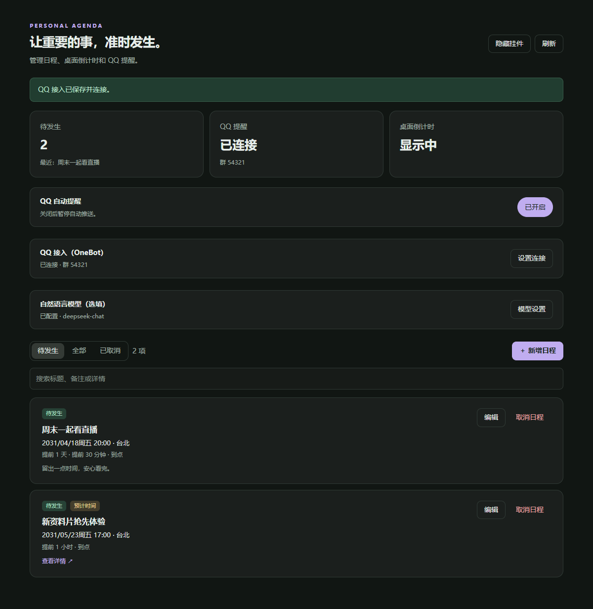

# 个人日程（`cortico-world-personal-agenda`）

Coopanion 个人日程、桌面倒计时挂件与 QQ（OneBot v11）自动提醒扩展（World API 6），支持按日程独立设置时区与可选的自定义语言模型。不读取或修改其他扩展配置与密钥。

- **GitHub 源码与完整文档**：[Nakamach1Arale/cortico-world-personal-agenda](https://github.com/Nakamach1Arale/cortico-world-personal-agenda#readme)
- **问题反馈**：[GitHub Issues](https://github.com/Nakamach1Arale/cortico-world-personal-agenda/issues)

## 主要特性

- **WebUI 日程面板**：支持新增、编辑、取消、重新启用、状态筛选、关键词搜索与并发编辑冲突保护。
- **独立桌面倒计时挂件**：置顶/折叠控制、临近提醒高亮、手动固定事项、直接识别详情中的直播链接，编辑或 QQ 变更后即时刷新；首次启用前在面板列出待复制文件与目标路径，经用户确认后再初始化运行环境。
- **独立时区与夏令时**：每条日程单独保存 IANA 时区（默认跟随电脑），自动处理夏令时缺失与重复时段。
- **直连 OneBot v11 提醒与命令**：直接连接 NapCat / OneBot 正向 WebSocket，不影响其他 QQ 扩展；支持私聊、群聊分别设置与按目标去重回执，并可按权限开放群内 `/日程 添加` 命令。
- **独立可选的语言模型**：可在面板按需配置兼容 OpenAI 接口的模型地址、模型名、本扩展专用 API Key 与提醒口吻；未配置时网页管理、倒计时与 `/日程` 命令照常可用。

## 快速使用

1. 在 Coopanion 扩展市场安装本扩展并重启核心，在 **World** 中启用 **个人日程**。
2. 无需 QQ 即可直接在面板中添加日程；如需桌面倒计时挂件，点击顶部 **启用桌面挂件** 并确认初始化说明即可。
3. 需要 QQ 提醒时，在面板打开 **QQ 接入（OneBot） → 设置连接**，填写接收 QQ 号或群号及 OneBot WebSocket 地址与令牌，点击 **检测连接** 后保存。
4. 如需自然语言管理日程，在 **自然语言模型（选填） → 模型设置** 中填写兼容 OpenAI 的模型配置即可。
