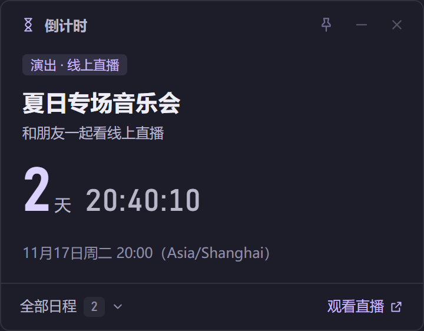

# 个人日程（`cortico-world-personal-agenda`）

Coopanion 个人日程、桌面倒计时挂件与 QQ 自动提醒扩展（World API 6），支持按日程独立设置时区，并可复用官方 QQ 插件（`cortico-world-qq`）连接。

- **GitHub 源码与完整文档**：[Nakamach1Arale/cortico-world-personal-agenda](https://github.com/Nakamach1Arale/cortico-world-personal-agenda#readme)
- **问题反馈**：[GitHub Issues](https://github.com/Nakamach1Arale/cortico-world-personal-agenda/issues)

## 主要特性

- **WebUI 日程面板**：支持新增、编辑、取消、重新启用、状态筛选、关键词搜索与并发编辑冲突保护。
- **独立桌面倒计时挂件**：置顶/折叠控制、临近提醒高亮、手动固定事项、直接识别详情中的直播链接，编辑或 QQ 变更后即时刷新；首次启动自动初始化桌面窗口运行环境。
- **独立时区与夏令时**：每条日程单独保存 IANA 时区（默认跟随电脑），自动处理夏令时缺失与重复时段。
- **QQ 提醒与官方插件复用**：默认复用官方 QQ 插件的连接，也支持手动连接 OneBot v11；支持私聊、群聊分别设置与按目标去重回执，并可按权限开放群内 `/日程 添加` 命令。
- **复用 Coopanion 语言模型**：自然语言日程管理与提醒文案自动沿用 Coopanion 当前启用的 `activeProvider`。

## 快速使用

1. 在 Coopanion 扩展市场安装本扩展并重启核心，在 **World** 中启用 **个人日程**。
2. 无需 QQ 即可直接在面板中添加日程与开启桌面倒计时挂件。
3. 需要 QQ 提醒时，在面板打开 **QQ 接入 → 设置连接**，填写接收 QQ 号或群号，保持默认的「复用官方 QQ」并点击 **检测连接** 后保存即可。
